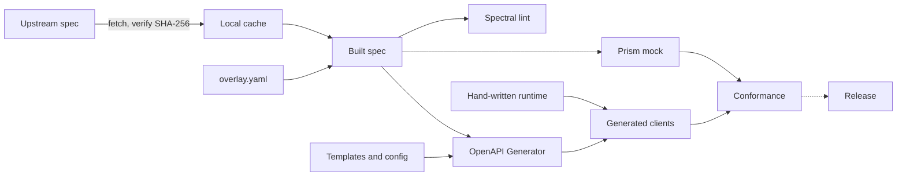

# Architecture

How this project turns a public OpenAPI spec into SDKs for five languages, and why it is built this way.

This project is unofficial and is not affiliated with, endorsed by, or supported by Back Market.

## Status

Sections below describe the design; this table says how much of it is real.

| Part | Status |
| --- | --- |
| Spec fetch, hash pin, overlay, lint, mock, CI | Built |
| Conformance format, runner, harness, cases and reference driver | Built |
| Generator config and templates | Built for Python, TypeScript, Go, C# and Rust |
| Per-language runtime | Built for Python, TypeScript, Go, C# and Rust |
| Python and TypeScript clients | Alpha, published |
| Go client | Alpha, tagged |
| C# client | Alpha, published |
| Rust client | Alpha, published, async only |
| Spec drift job | Built |
| Release workflows and changelogs | Built per API. Publishing on for Back Market, off for Etsy |
| Quickstarts | Built for Python, TypeScript, Go, C# and Rust |

## Goals

* Cover the public Seller API in Python, TypeScript, Go, C# and Rust.
* Stay correct as the upstream spec changes, with one place to fix each problem.
* Feel native in each language: public names follow that language's conventions.
* Behave the same in every language, proved by one shared test suite.
* Stay small enough for one maintainer to keep current.

## Non-goals

* Anything outside the public spec and public docs, including undocumented endpoints.
* Buyer flows or crawling.
* A general SDK framework. The code is arranged so that one could be extracted later, and that is all.
* Testing against the live API. See [Testing limits](#testing-limits).

## Pipeline



Dashed edges are planned.

1. **Upstream spec.** `apis/backmarket/spec/upstream/lock.json` records the URL, SHA-256, `info.version`, `Last-Modified` and retrieval date. The spec itself is not in this repository. `npm run spec:fetch` downloads it to a gitignored cache and checks the hash. A mismatched download is never cached, and a mismatched cache stops the build with an error that says how to recover. Once cached, the build and tests need no network.
2. **Overlay.** `apis/backmarket/spec/overlay.yaml` holds our corrections, in [OpenAPI Overlay](https://spec.openapis.org/overlay/v1.0.0.html) format. Each one is explained in `apis/backmarket/docs/spec-audit.md`. `npm run spec:build` applies them and writes `apis/backmarket/build/openapi.yaml`, and fails if an action matches nothing, so a correction cannot quietly stop applying.
3. **Lint and mock.** Spectral lints the built spec. Prism serves it as a mock on port 4010.
4. **Generator.** OpenAPI Generator, at the version and SHA-256 in `toolchain/generator/lock.json`, turns the built spec into one client per language, with custom templates where its defaults are not idiomatic. `toolchain/pipeline/generate.mjs` first strips descriptions, summaries and examples, so the committed clients carry no upstream prose, then applies the package's `generate.yaml` and `operations.yaml`, which hold its public names and our own summaries. An `operations.yaml` entry may instead set `omit` to the reason an operation is left out, and that operation is not generated.
5. **Runtime.** A small hand-written library per language supplies what the generator does badly. The generic part lives in `toolchain/runtime/<language>/` and is copied into each package on generation; what is specific to this API, such as servers and the error table, sits in the package.
6. **Conformance.** One set of cases runs against every language. A language is not supported until it passes.
7. **Release.** Each package is published by a release workflow. See [Versioning and release](#versioning-and-release).

The upstream spec is OpenAPI 3.0.3, with 40 operations on 35 paths and 75 schemas. `spec-audit.md` lists its known gaps and where each is handled: overlay, runtime, generator config, or left open because only live access could settle it.

### APIs built from several contracts

Some vendors publish one OpenAPI file per API rather than one for everything. Such an API lists its files under `sources` in `lock.json`, each with a `name` (lower case, digits and `_`) and the same fields a single pin has. A lock with a top-level `url` keeps working as before, and the files below are only used for named sources.

* **Fetch.** `spec:fetch`, `spec:pin` and `spec:verify` handle every source. Each is cached as `spec/upstream/contracts/<name>.yaml`. `spec:pin` downloads all of them before writing anything, so one failure leaves every pin as it was. A response with an empty body is refused as "no spec at this URL", even with HTTP 200, because some hosts answer a missing file that way.
* **Overlay.** One overlay per contract, at `spec/overlay/<name>.yaml`, so each targets one file with the paths and names upstream uses. A contract with nothing to correct has no overlay. Corrections every contract needs go once in `spec/overlay.yaml`, which is applied to each contract before its own overlay; each of its actions must match in at least one contract.
* **Build.** Each contract is corrected on its own, then the path its servers share, server variables filled with their defaults, moves into its paths, leaving each server only its origin. Servers in one contract that disagree on that path stop the build, and an operation with no server anywhere counts as the implicit `/`. Each result is written to `build/contracts/<name>.yaml`.
* **Mock and lint.** Prism serves one document, so `build/openapi.yaml` merges the contracts: every component name, security scheme and operation ID gets the contract's name and a dot as a prefix (`orders.Error`), because contracts reuse schema names. Discriminator mappings that use bare schema names or are left implicit are first spelled out as references, so they still resolve. A path two contracts both declare stops the build. Spectral lints the merged document, and conformance cases name operations as `<name>.<operationId>`.
* **Generate.** Each contract is generated from its own build into its own sub-module, so contracts never share a model namespace. `contracts` in `generate.yaml` maps every contract to the settings it overrides, such as `output`, `source`, `operations` and `properties`; the runtime is copied once, for every sub-module to share. Shared names in `packages/names.yaml` sit under each contract's name. Python's templates import that shared runtime from the `runtimePackage` property, the package root. Each other language's templates are adapted the same way with its first package built like this.
* **Drift.** The cache key covers every source's hash. The drift pull request and its commit give each contract's new hash, and the pull request names each contract that changed and says in bold which ones lost operations.

## Boundary between toolchain and API

| Path | Holds |
| --- | --- |
| `toolchain/` | Pipeline, templates, runtime and conformance runner |
| `apis/backmarket/` | Spec pin, overlay, package config, conformance cases and spec audit |
| `apis/etsy/` | The same for Etsy's Open API v3, with Python, TypeScript, Go, C# and Rust packages so far |
| `apis/ebay/` | The same for eBay's Sell, Commerce and Developer APIs, built from 20 contracts, with Python and Rust packages so far |

`toolchain/` must not name this API or contain its endpoints or schemas. `apis/backmarket/tests/boundary.test.mjs` enforces that. API-specific values the toolchain needs arrive as configuration or case data: the conformance error kinds, for example, are defined by the cases, not by the runner.

The npm scripts take the API directory from the `API` environment variable, defaulting to `backmarket`: `API=<api> npm run spec:build`. CI finds each directory under `apis/` with a `spec/upstream/lock.json` and runs the spec job for it, then runs each language job for every API that has a `packages/<language>/generate.yaml`.

The boundary only keeps a later extraction cheap. It does not justify building anything this SDK does not need.

## Generated and hand-written code

| Generated | Hand-written |
| --- | --- |
| Models and serialisation | Auth, timeouts and retries |
| One method per operation | Rate-limit handling |
| | Pagination iterators |
| | Typed errors and redacted logging |

Generated code is never edited by hand. Each problem has one fix:

* The spec is wrong: add an overlay action and record why in `spec-audit.md`.
* A name or shape is poor in one language: change that language's generator config or templates.
* The behaviour cannot be expressed in the spec: change the runtime.

Generated clients are committed under `apis/backmarket/packages/<language>/`, so a spec change shows up as a reviewable diff. CI regenerates them and fails if the result differs.

The spec has been wrong before, so clients do not trust it when reading. Requests are validated against the models, but a response that does not fit them still reaches the caller, with the raw value in place of the field that failed. In Python, as in Go, a top-level body that is not the declared type at all raises `decode` with the body in `raw_body`, and method arguments are checked against their annotations, constraints such as a maximum page size included, before anything is sent. In TypeScript the models are types only, so requests are checked at compile time and responses are decoded JSON.

Model fields follow each language's conventions where a client maps them. The TypeScript client does not: it keeps the API's field names, because any mapping would need per-model code at runtime, and unknown or mistyped fields are meant to pass through. Its methods, parameters and options are camelCase.

Go cannot put a raw value in a typed field, and has no optional values. So each Go model is a struct of pointers, one for every field, and an `Extra` map. A value that does not fit stays nil and goes to `Extra`, along with unknown fields and nulls, and `json.Marshal` restores them all. Required fields are pointers too, because the spec's `required` is unconfirmed, and an absent field must read differently from a zero. A top-level body that is not the declared type has nowhere to go, so it raises `decode` with the body in `raw_body`. Union schemas become `any`.

In Rust, every model field is an `Option`, a field holding another model is boxed so recursive schemas compile, and each model has an `extra` map. Decoding moves a field from `extra` into its typed slot only when the value fits, so a mismatched value, a null or an unknown field stays in `extra`, and serialising gives all of it back. Enumerations are open, with an `Unlisted` variant for values this version does not list. Fields the spec types several ways are `serde_json::Value`. Date-times are `chrono::DateTime<FixedOffset>`, which keeps the offset the API sent, and one that is not RFC 3339 stays in `extra`. UUIDs are `String`. Because every field is an `Option`, Rust does not check a request for its required fields; the API rejects one that lacks them.

## Runtime contract

Every language implements the same behaviour. The conformance cases are the authority, and `spec-audit.md` has the reasoning. Nothing here has been confirmed against the live API.

### Credentials

Each runtime takes a credential provider instead of a single secret. The provider has three parts:

* `apply` runs before every attempt, retries included, and receives the final request: method, absolute URL, headers, body bytes and the operation. It may change only the headers, so it can add a static header, a bearer token or a signature over the whole request. It is asynchronous where the language is.
* `secrets` lists every value to redact. It is read again each time, so it may change as tokens rotate.
* `refresh`, optional, runs after a 401. A call refreshes at most once and retries at most once, so a 401 never loops. Calls on one client share one refresh: a call whose credentials were refreshed after it sent them retries without refreshing again.

Each generated operation carries the spec's security requirements: the alternatives, each listing the scheme names and scopes it needs. A provider reads them to decide what to apply. An API package builds the provider; the runtime holds nothing specific to any scheme.

TODO: a helper for tokens that are minted and refreshed, with a persist callback that accepts a missing refresh token and an optional early refresh before `expires_in`, once a second API needs it. Until then the interface covers it and the API package implements it.

### Message signatures

Each runtime has a `MessageSigner` for HTTP message signatures (RFC 9421). An API's provider calls it at the end of `apply`, so every attempt is signed again with a fresh `created` time. It adds `Content-Digest: sha-256=:<base64>:` (RFC 9530) over the exact body bytes when there is a body, then `Signature-Input` and `Signature` over the configured components: lowercase field names and `@method`, `@target-uri`, `@authority`, `@scheme`, `@request-target`, `@path` and `@query`. A covered `content-digest` is left out of a request with no body. Most HTTP libraries add `Content-Length` and `Host` after `apply`, so a request without them signs the body's length, when there is a body, and the URL's authority, which are what the library sends. Any other missing field is an error. An empty query counts as none: `https://example.com/p?` has `@request-target` `/p` and `@query` `?`. `keyid`, `alg` and `expires` are optional parameters, and the lifetime that sets `expires` must be whole seconds, at least 1. C# rejects a signature base that is not ASCII rather than replacing characters. The signer names no API, so a header that identifies the key belongs to the API's provider.

The key is an unencrypted PKCS #8 PEM, Ed25519 (`ed25519`) or RSA (`rsa-v1_5-sha256`). It is a secret: the signer lists the PEM, its base64 body and each line of that body of 16 characters or more for the provider's `secrets`, and never prints it, Go's value included. Go and TypeScript use their standard libraries. Python uses `cryptography`, imported only when a signer is built. .NET has no Ed25519, so C# uses BouncyCastle for it, and Rust uses `aws-lc-rs`, which rustls already brings in. A package that does not sign leaves the signer's dependency out: Python never imports `cryptography`, C# removes the file from its build, Rust builds it only under a `signing` feature or in tests, and Go leaves it out of the binary as unused code. TypeScript still ships `runtime/signing.js` in `dist`, with no dependency; a consumer's bundler drops it.

TODO: an opt-in in `generate.yaml` so the generator copies the signer only into packages that sign, once a second API signs. Until then each C# package that does not sign needs `<Compile Remove="Runtime/MessageSigner.cs" />`.

### Authentication and headers

* Back Market uses a static provider that sends `Authorization: Basic <token>` with the token verbatim: no username and no base64. Generated Basic-auth helpers must not be used.
* `User-Agent` is required client configuration, because the API may refuse a request without it and no default can be correct.
* Send `Accept-Language` on every call, from a client-level locale.
* Do not force a JSON `Content-Type` on multipart operations.
* Select a server by region and environment rather than a raw URL.

### Hosts and environments

An API may serve operations from several hosts. `hosts` in its `sdk.yaml` maps each server URL to a host key, and the generator gives every operation the key of its first server (its own, its path's or the spec's) as `x-sdk-host`, unless the overlay set one. An overlay's `x-sdk-host` must be one of the keys. Without `hosts`, operations carry no key, and an overlay `x-sdk-host` is an error.

* Settings hold `base_url` and a `hosts` map from host key to base URL. An operation with no key goes to `base_url`; one with a key goes to that key's URL.
* A key missing from `hosts` is a configuration error, raised before credentials are applied or anything is sent. No request ever goes to a host outside the settings, so credentials never do.
* Iterators reissue each page against the operation's own host.
* A package may define named environments, each a full host map. The runtime's `select_hosts` (named per language) returns the map for an environment, or validates a caller's own map: it must name exactly the keys the environments use. Either way, trailing slashes are removed from every URL. An unknown environment is an error that lists the known ones.

### Default header parameters

`header_defaults` in `sdk.yaml` names header parameters that take a client-level default, matched without regard to case. The generator marks each with `x-sdk-header-default`, makes it optional, and templates expose it as an optional method argument; other header parameters stay unexposed. Settings hold `header_defaults`, a map from header name to value. A name in `sdk.yaml` that matches no header parameter fails generation, and two names in the settings that differ only by case fail when the client is built.

* A value passed to the call is sent. Otherwise the default for that header is sent, matched without regard to case, under the name the operation declares. Otherwise the header is not sent.
* Only operations that declare the header send it; a default never reaches any other operation.
* The value replaces any client-wide header of the same name, and credentials see it before every attempt.

Headers the runtime owns, `Content-Type`, `Content-Length`, `Accept` and `Accept-Encoding`, are never method arguments: the generator drops them from every operation, and `header_defaults` may not name them.

No API uses `hosts` or `header_defaults` yet, so CI's `templates` job generates a synthetic spec in `toolchain/pipeline/fixtures/multihost/` in every language and type-checks the result. It has two hosts with one operation each, and a default header on one operation that has no other parameter. Its generated code is not committed.

### Binary bodies

A body the spec declares as `type: string, format: binary` is bytes, never text. The overlay declares it that way where upstream does not. The generator marks a binary success response `x-sdk-binary-response` and a request body whose one media type is binary, and neither JSON nor a form, `x-sdk-raw-body` with that media type. Generators type neither one.

* **Downloads.** The call returns a download: the response's `Content-Type`, empty if it has none, and the body as a stream of bytes, with a way to read it whole. The caller closes it. The request asks for `Accept-Encoding: identity`, and the body is passed on as received, compressed or not. TypeScript is the exception: Node's fetch decodes a `gzip`, `deflate` or `br` body whatever was asked for, so its download holds the decoded bytes. An empty body is an empty download, not an error.
* **Deadline.** The attempt's deadline keeps running while the caller reads the stream, so a timeout must cover the whole transfer. Reading past it fails with `timeout`, and a connection that drops mid-body fails with `connection`.
* **Retries.** Failures before the download is returned are retried as usual. Nothing is retried once it is, because the caller may have read part of it.
* **Uploads.** A raw body is a required argument, sent unchanged with the declared media type as `Content-Type`. It is bytes, or a stream in languages that have one. TypeScript takes a web `ReadableStream`; a Node stream goes through `Readable.toWeb`. Bytes are retried and refreshed as any body is, and credentials see them. A stream is sent once: a failure that would resend it raises the error instead, and credentials see an empty body, so a signer cannot digest it. Where the caller keeps the stream, as with a Go `io.ReadCloser` or a .NET `Stream`, the call leaves it open. TODO: let a signing provider read a replayable stream.
* **Errors and redaction.** A failure response is read whole as text and mapped to its typed error, redacted, as for any other operation. Redaction never runs over a binary body, and logs give no binary content.

A text response that is not JSON, such as `text/plain` or `text/tab-separated-values`, is returned as text, as before.

An empty 204 is no result: `None`, `undefined`, `nil`, `null` or the type's default, even where the operation also declares a JSON success. An empty body with any other status is a decode error where JSON is declared. TODO: make the return type optional where an operation declares a 204 beside a JSON success.

### Timeouts

The timeout is one deadline for each attempt, from sending the request to reading the last byte of the response, and is configurable. A body that keeps trickling must not outlast it. A timeout that exhausts its retries raises a `timeout` error.

Python's synchronous client cannot interrupt a blocking read, so it checks the deadline as each chunk arrives. There, a stalled read can overrun by up to one timeout, and headers that trickle are not caught. Runtimes with cancellation, including Python's asynchronous client and the TypeScript client, must enforce the deadline exactly.

### Retries

| Failure | Retried for | Delay |
| --- | --- | --- |
| 429 | Every method | `Retry-After` if usable, otherwise at least 10 seconds |
| 5xx, timeout, connection failure | GET only | Exponential backoff |
| Any other response | Never | |

Only GET is retried on 5xx, timeouts and connection failures because the API documents no idempotency key, and a repeated refund could refund twice. A 429 is safe to retry on any method, because the request was refused.

`Retry-After` is either whole seconds or an HTTP date, in which case the wait runs until that date. Any other value counts as no header, and so does a date in the past: it says nothing about how long the block lasts, and it can be clock skew, so retrying at once would risk another 429.

A `Retry-After` longer than the maximum wait is not waited for, and the call raises `rate_limited` at once, with the header's value on the error so the caller can reschedule. Blocking a caller for an hour is worse than handing the decision back, and retrying early would only earn another 429. The maximum applies to `Retry-After`, not to the rate-limit wait.

The retry count, backoff base, rate-limit wait and maximum wait are configurable. The reference driver defaults to 3 retries, a 500 ms base, a 10 second wait and a 60 second maximum, and the runtimes should match it.

### Rate limits

The spec publishes limits only in prose, and declares no `Retry-After` or `X-RateLimit-*` header. So the runtime reacts to 429 on every operation and does not throttle in advance. A 429 that outlasts its retries raises `rate_limited`.

### Pagination

The API has four pagination styles, and the iterator hides them. It stops when `next` is null, the only end signal all four share. `count` does not drive iteration, because its meaning varies by endpoint.

The iterator reads the `page` or `cursor` value out of `next` and reissues the request against the configured server. It never fetches `next` directly: that URL could send the token to another host.

These rules are the toolchain's `next_link` paging style, set for this API in `apis/backmarket/sdk.yaml`. An operation can override it with `paging` in its package's `operations.yaml`. The other style, `offset`, is for APIs that page by offset: it advances the offset parameter by the number of items received and stops at an empty page or once the offset reaches the page's total, which may be any JSON number. The caller's own starting offset and limit are kept. In either style a page without its items list is a decode error, and so in `offset` is a starting offset that is not an integer.

### Typed errors

Errors map on status first, then parse the body best-effort. A body that fits no known shape, or is not JSON, still produces a typed error with the status and the raw text, with the token removed. A failure response whose compressed body cannot be decompressed produces the same error with an empty body, and is retried as usual.

| Kind | Meaning |
| --- | --- |
| `bad_request`, `authentication`, `not_found`, `validation` | 400, 401, 404, 422 |
| `permission`, `waf_blocked`, `bot_challenge` | The three kinds of 403 |
| `rate_limited`, `server` | 429 and 5xx, after retries |
| `api` | Any other status |
| `timeout` | No response in time, after retries |
| `connection` | The connection failed or dropped before a full response, after retries |
| `decode` | A success response other than 204 whose declared JSON is empty or does not parse, or whose compressed body cannot be decompressed or ends early; a page whose `next` link is not a valid URL. Never retried. |

Errors also carry `request_id`, `code` and `cf_ray` when present. Each language exposes these under its own naming conventions.

### Redaction

No secret the provider lists may appear in any result, error or log, at any log level. There may be any number of them, of any length, such as a PEM key or a JWE; the longest is removed first, so a secret that contains another goes whole. Every conformance case asserts this for the token and every other secret, whatever else it tests.

## Conformance format

Cases are YAML, kept in `apis/backmarket/conformance/cases/`. Each states a request, the mock response, the exact wire traffic expected, and the expected result or error. The full format is in `toolchain/conformance/README.md`, and the error kinds are in `apis/backmarket/conformance/README.md`.

```text
runner ── JSON lines ──> driver (one per language) ── HTTP ──> harness ──> Prism, or a scripted response
```

* A **driver** is a small executable beside each language package. It calls the public client, so the suite tests what users get.
* The **harness** records every request. It answers from Prism, which also rejects requests the spec does not allow, or from a script, for what Prism cannot do: response sequences, delays, slow bodies, dropped connections, HTML bodies and undeclared statuses.
* The **reference driver** is a minimal JavaScript client that proves each case can pass. It is test code, not an SDK, and `npm test` runs it.

There are 81 cases, covering auth, pagination, 4xx and 5xx errors, 429 retry, timeouts, connection failures, redaction and 30 of the 40 operations. CI runs them with the reference driver and with each language's client: Python sync and async, the TypeScript ESM and CommonJS builds, Go, C# and Rust.

## Versioning and release

* Each language package has its own semantic version and changelog. Every user-visible change needs a changelog entry. A change adds its entry under `## Unreleased` at the top of the changelog and leaves the package version alone; only the release pull request sets the version.
* Packages stay on 0.x until outside users confirm behaviour against the live API. In 0.x, a breaking change bumps the minor version.
* Python and TypeScript are published first, as alphas. The others follow as each passes conformance. A later language never delays an earlier release.
* Publishing is done only by a release workflow. Each package's first publish is approved by the maintainer.

| Language | Package |
| --- | --- |
| Python | `backmarket-seller` on PyPI |
| TypeScript | `backmarket-seller` on npm |
| Rust | `backmarket-seller` on crates.io |
| C# | `BackMarketSeller` on NuGet |
| Go | Module in this repository, versioned by git tag |

Every package description and README says the project is unofficial and not affiliated with Back Market. Each package ships `LICENSE` and `NOTICE`. The Apache-2.0 licence covers only this project's own code; it does not cover the upstream spec or grant any right to the Back Market name.

### Publishing a package

`.github/workflows/release-python.yml`, `release-typescript.yml`, `release-csharp.yml` and `release-rust.yml` each release that language's package for every API. A target job reads the API and version from the tag, through `.github/actions/release-target`. A build job then reruns the generated-code check, the package tests and conformance, and builds the package. A publish job uploads it. On a pull request that touches a package version or changelog, the build job dry-runs every API that has that package, and nothing is published.

Release tags are `<api>/<language>/v<version>`, such as `etsy/python/v0.1.0a1`. Back Market's tags from before tags named the API, `<language>/v<version>`, still release Back Market. Go has no release workflow: its module is versioned by the tag `apis/<api>/packages/go/v<version>`, which Go requires.

| Language | Tags | Environment | Repository variables |
| --- | --- | --- | --- |
| Python | `<api>/python/v<version>` | `pypi` | `PUBLISH_PYTHON` and `PUBLISH_<API>_PYTHON` |
| TypeScript | `<api>/typescript/v<version>` | `npm` | `PUBLISH_TYPESCRIPT` and `PUBLISH_<API>_TYPESCRIPT` |
| C# | `<api>/csharp/v<version>` | `nuget` | `PUBLISH_CSHARP` and `PUBLISH_<API>_CSHARP` |
| Rust | `<api>/rust/v<version>` | `crates-io` | `PUBLISH_RUST` and `PUBLISH_<API>_RUST` |
| Go | `apis/<api>/packages/go/v<version>` | None | None |

Each environment needs the maintainer's approval, and allows only tags matching `*/v*` and `*/*/v*`. `<API>` is the API's directory name in capitals, with `-` as `_`, so Etsy's Python variable is `PUBLISH_ETSY_PYTHON`. A publish job runs only when both variables are `true`, so an API cannot publish until the maintainer turns its own variable on. Back Market published before per-API variables, and needs only the language variable.

One workflow serves every API, because each registry's trusted publisher is set on the package and names the workflow file and environment, which every API shares. Before an API's first release, the maintainer sets up each registry:

| Registry | First release |
| --- | --- |
| PyPI | Add a pending trusted publisher for the new project: this repository, workflow `release-python.yml`, environment `pypi`. The first publish creates the project. |
| npm | Trusted publishing needs the package to exist. Publish the first version by hand with a short-lived token, from the tarball the release run built, then add a trusted publisher: this repository, workflow `release-typescript.yml`, environment `npm`. Revoke the token. |
| NuGet | Make sure a trusted publishing policy for this repository, workflow `release-csharp.yml`, environment `nuget`, covers the new package ID. |
| crates.io | Trusted publishing needs the crate to exist. Publish the first version by hand with a short-lived token, from the tagged commit, then add a trusted publisher: this repository, workflow `release-rust.yml`, environment `crates-io`. Revoke the token. |

To release, rename `## Unreleased` in the package changelog to `## <version> (<date>)`, set that version in the package manifest, merge, and tag that commit on `main`. The build job fails unless the tag names an API with that package, matches its version and changelog, and the commit is on `main`.

A release run can be rerun after it published. Each publish job skips a version the registry already has: `skip-existing` for PyPI, `--skip-duplicate` for NuGet, and a registry lookup before `npm publish` and `cargo publish`. `apis/backmarket/tests/workflows.test.mjs` checks this, and how tags map to APIs.

## Spec updates

Upstream serves only its latest spec, so an older pin cannot be fetched again. Once upstream changes, a machine with no cached copy fails closed until the pin moves. Released versions are unaffected, because their generated code is committed.

CI and release jobs get the spec through `.github/actions/upstream-spec`, which restores it from the Actions cache under `upstream-spec-<sha256>`, the hash in that API's `lock.json`, at that API's path, and downloads it only on a miss. Caches saved on `main` are visible to every pull request and tag, and the spec drift job keeps them there, so an upstream change does not break an unrelated pull request or release. Only the spec drift job reads upstream on purpose. A pull request from a fork can restore those caches too, but the spec is never committed, uploaded as an artifact or attached to a release, so the repository does not redistribute it. `apis/backmarket/tests/workflows.test.mjs` fails if any other job fetches the spec itself.

To move the pin by hand, run `npm run spec:pin`, review what changed, and commit `lock.json`. It rewrites the hash, version, `Last-Modified` and date in the lock, and replaces the cached spec. On other machines the old cache then fails verification; delete it and run `npm run spec:fetch`.

`.github/workflows/spec-drift.yml` automates that. It runs daily and on demand, once for each API under `apis/` that has a `spec/upstream/lock.json`:

1. Restore the pinned spec from the cache, which also keeps it from expiring, and keep a copy of it.
2. Run `spec:pin` and compare the new SHA-256 with the old one. Save the downloaded spec to the cache under its own hash, unless the pinned spec was already there. That restores an evicted pin while upstream still matches it, and has the next pin cached before its pull request runs. Stop if the hashes match, or if an open pull request from that API's `spec-drift-<api>` branch already proposes the new hash, so fixes pushed to that branch are kept. A drift pull request closed without merging does not stop the next run.
3. Rebuild the spec and regenerate the clients. If an overlay action stops matching, skip regeneration and say so in the pull request. If regeneration fails, discard its partial output, still open the pull request, say so with a link to the run, and leave the run red.
4. Commit `lock.json` and the regenerated clients to the `spec-drift-<api>` branch, and open or update a single pull request for that API.
5. In the pull request, list which operations and schemas were added, removed or changed between the old and new upstream specs, by name only, and count those whose only changes are descriptions or examples. `toolchain/pipeline/spec-diff.mjs` writes this. If the cache held no old copy, it says that no comparison was possible.

The pull request goes through ordinary CI, which restores the new spec from the cache, verifies it against the new hash, then runs the build, lint and conformance. If upstream changed something the overlay corrected, CI goes red, which is the signal to fix it on that branch. If upstream changes again before merge, the next run resets the branch to the newer spec. The job never merges its own pull request.

A pull request opened with the default workflow token does not trigger `pull_request` workflows, and that token can open one only if the repository allows Actions to create pull requests. The job uses the `SPEC_DRIFT_TOKEN` secret when it is set: a fine-grained token for this repository with contents and pull request write access. Without it, the job falls back to the default token and the pull request says to close and reopen it to start CI. Only the final step, which pushes and calls `gh`, receives that token; checkout does not persist credentials, so dependency installs and generators never see it.

`apis/backmarket/tests/drift.test.mjs` fails if a package with a `generate.yaml` has no `generate:<language>` script for the job's regeneration step to run, if the write token reaches any other step, or if a failed regeneration would skip the pull request.

## Credentials

Users supply their own token at runtime and pass it to the client. The SDKs store nothing.

This project has no API credentials: none in CI, none in secrets and none for testing. Fixtures are synthetic, and the token in every conformance case is a made-up value.

## Testing limits

Everything runs against a mock built from the spec, so the tests prove that clients match the spec and each other. They do not prove the spec matches the API.

* **Prism is the spec, not the service.** A wrong spec passes. The overlay's corrections are inferred from the spec's own text.
* **Runtime rules are inferred from prose.** Retry, rate-limit and error behaviour comes from the spec's descriptions and has not been observed.
* **Scripted responses skip Prism.** Most 5xx and 429 cases are scripted, so those requests are checked only against their `wire` entries, not against the spec.
* **The reference driver shows that cases can pass, not that they are right.**
* **Coverage is partial.** 10 of the 40 operations have no case yet, mainly multipart, messages and secondary reads.
* **Some questions stay open.** `spec-audit.md` lists what only live access can settle, and no guess is encoded for those.

This is why the packages stay on 0.x. Reports from users of the live API are the only way to close this gap, and they are welcome as GitHub issues.

## Decisions

### Generate from the spec instead of writing SDKs by hand

Five languages, 40 operations and 75 schemas are too much to keep in step by hand, and the spec changes without notice. Generation gives one place to fix each mistake and makes a spec change a mechanical update.

Hand-written SDKs can read better, and that remains the cost of this choice. Custom templates and config set public names, and the hand-written runtime handles the behaviour where generators are weakest.

### OpenAPI Generator instead of a paid generator

Commercial generators can produce more idiomatic output with less template work. They also add a recurring cost and a dependency on a vendor's product, and they would stop a contributor from reproducing the build without an account.

OpenAPI Generator is open source and can be pinned, so anyone can run the same build. The price is that we own the templates and the runtime.

### No shared native core

A Rust or C core behind FFI bindings would centralise retries, pagination and errors. It would also mean native builds for every platform and language, harder installs, and awkward fits with each language's async model.

HTTP is already the language-neutral layer, and the logic in question is small. The shared part of this project is the conformance suite: behaviour is specified once and implemented per language.

### One repository for all languages

The overlay, conformance cases and generated clients change together. In one repository, a spec fix and its effect on every language land in a single reviewable pull request, and CI proves them together.

The cost is a mix of toolchains in one CI setup, and per-package versioning and tags instead of one repository per release stream.

### No separate generator repository yet

With only one API, a separate repository would add versioning and coordination cost in exchange for a framework shaped by a single example. `toolchain/` stays generic and the boundary test keeps it that way, so extraction stays cheap. That decision waits for a second API.

### Fetch the spec at build time instead of storing it

The upstream spec has no licence statement, so this repository does not redistribute it. The pin keeps builds reproducible without the file: a build either uses exactly the reviewed spec or fails.

The cost is the dependency on upstream described in [Spec updates](#spec-updates). The overlay stays ours, and quotes as little upstream text as practical.
